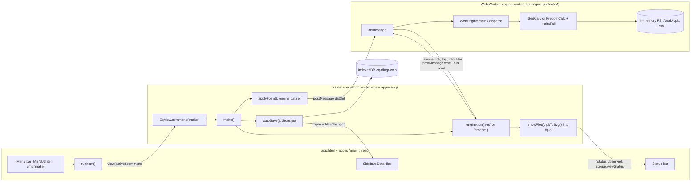

# Eq-Diagr web app: overview for an external reviewer

State after review batch 4 and the additions of 2026-11-27 (colour themes, live mode with sliders, readout on the diagram, links, drag and drop, printing; see `REVIEW.md`, last section). Paths are relative to the repository root. Screenshots are in `review/` (list in §3). This document describes; it does not evaluate the chemistry.

## 1. Purpose and users

The app is a browser version of **eq-diagr** (Chemical Equilibrium Diagrams, by Ignasi Puigdomènech; upstream https://github.com/ignasi-p/eq-diagr, GPL-3), a Java desktop suite used in teaching and research to draw aqueous chemical equilibrium diagrams: fraction, logarithmic-concentration, solubility, calculated pH/pe and predominance-area (Pourbaix) diagrams. The upstream Java calculation code (DataBase search, HaltaFall, SED, Predom, PlotPDF, PlotPS, ModChemSyst, ModReaction, DataMaintenance) is compiled to JavaScript with TeaVM and runs in a Web Worker. There is no server-side code.

Users: students in a classroom (normal mode, which hides most options) and advanced users (advanced mode, all options of the desktop programs).

Typical workflow (screenshots `review/01`–`05`):
1. Open `webpoc/web/app.html`. The **Chemical system** tab shows a periodic table; the KTH course database KD1280 is loaded and H⁺ is preselected.
2. Click an element (e.g. Fe), then a component (Fe 2+).
3. Optionally set temperature/pressure (and, in advanced mode, solids, redox and water options).
4. Click **Search**: the engine finds all complexes and solids of the selected components; the result table lists species, log *K*, reference.
5. Untick species to leave out (the search reruns).
6. Click **Create a diagram**: the generated data file (`.dat`) is saved in IndexedDB and opened in a new diagram tab, with a default diagram (log concentrations vs pH).
7. In the diagram tab, change the diagram type, axes and concentrations (pH, pe/Eh, log *P*, total concentrations), optionally exchange components or switch reactions off.
8. Click **Plot the diagram** (Ctrl/⌘+Enter): SED or Predom runs in the worker; the plot file is rendered as SVG next to the settings; the `.dat` is saved again. With **Live** ticked the diagram is made again after every change, and each fixed concentration has a slider.
9. Point at the diagram to read the coordinates (and, for most SED diagrams, the species at that X-value) under it.
10. Export as SVG, PNG, PDF, EPS, `.plt`, `.csv` table or `.dat`; print the diagram; or copy a link that carries the data file.

## 2. Stack

| Layer | What | Version / notes |
|---|---|---|
| UI | Plain HTML, CSS and JavaScript (ES2017+: classes, async/await; IIFE modules, no framework, no bundler, no npm dependencies) | `webpoc/web/*.html`, `*.js`, `*.css` |
| UI components | Hand-written; native `<dialog>`, `<details>`, `<select>`; no component library | see §6 |
| Calculation engine | Java 8 source of eq-diagr (upstream `master` c94b0d8 plus two local patches) compiled to JS with **TeaVM 0.14.1** into one file | `webpoc/web/engine.js` (3.9 MB, committed build output) |
| Engine bridge | Java classes in `webpoc/src/webec/` (`WebEngine.java` entry point, `DatModel`, `SysEdit`, `Json`, `Fmt`, `FloatMath`, AWT/Swing stand-ins) and `webpoc/src-db/` (`DbOps`, `DbMaint`, `DbTools`) | JSON in/out via `globalThis.engineInput` / `engineReport` |
| Worker / client | `webpoc/web/engine-worker.js` (Web Worker), `webpoc/web/engine-client.js` (`EqDiagrEngine`, promise API, serial queue, `stop()` restarts the worker) | |
| Persistence | IndexedDB (`webpoc/web/store.js`, DB `eq-diagr-web`, stores `files`, `databases`, `settings`) and `localStorage` (mode, sidebar, colour theme, diagram style, live mode, search options) | browser only |
| Build | `webpoc/build-web.sh` (bash, python3, perl, javac `--release 8`, TeaVM CLI) | needs JDK ≥ 11 (used: OpenJDK 11.0.24) |
| Dev server | `webpoc/serve.py` (Python `http.server` with `Cache-Control: no-cache`) on 127.0.0.1:8765 | |
| Tests | Node (used: v25.9); `playwright-core` 1.52.0 for the UI test (`package.json`); Java for reference runs | §8 |

**Run (development):** `python3 webpoc/serve.py 8765`, then open `http://127.0.0.1:8765/app.html`. Any static file server works; the pages need HTTP (not `file://`) for the Worker and `fetch`.

**Run (production):** not deployed. Production would be any static host serving `webpoc/web/` as is (no build step for the UI). Serving the bundled release databases publicly has not been cleared with the upstream author (see §9).

**Rebuild the engine:** `webpoc/build-web.sh [path-to-eq-diagr]`. It needs (a) an eq-diagr checkout with the two patches in `patches/` applied (local branch `calc-split`: SED/Predom calculations and the database search separated from their Swing windows), and (b) the TeaVM 0.14.1 jars in `webpoc/teavm-lib/`. Both `eq-diagr/` and `webpoc/teavm-lib/` are git-ignored (`.gitignore`), so the repository alone cannot rebuild `engine.js`. The script also patches upstream sources on copy (`webpoc/patch_*.py`, perl one-liners for `String.format`, `(float)` casts, `java.awt` geometry) and regenerates `tests-data.js`, `sed-examples.js`/`predom-examples.js` and the help (`webpoc/make_help.py`).

Dependencies that matter: TeaVM (Java→JS; its class library lacks `%e/%g` formatting, float casts and AWT, hence the patches), upstream eq-diagr source, browser support for Web Workers, IndexedDB and `<dialog>`.

## 3. Directory tree (depth 3, generated/vendored folders omitted)

```
.
├── APP_OVERVIEW.md                this document
├── eq-diagr-review.md             running engineering notes: architecture review, test results, decisions (2026-10 → 11)
├── eq-diagr-split-proposal.md     proposal for upstream: separate SED/Predom/DBSearch from Swing (= patches/)
├── patches/                       0001 SED/Predom calc split, 0002 DBSearch window split (git format-patch vs upstream c94b0d8)
├── build-cli.sh, test-cli.sh      earlier phase: build self-contained CLI jars (jars/, ignored) and regression-test EC.jar
├── results/, test-runs/, test-split/   earlier phase: outputs of CLI runs used in eq-diagr-review.md
├── review/                        screenshots for this review (01–13, see list below)
├── REVIEW.md                      review feedback: what was done, deviations, open questions
├── package.json                   devDependency playwright-core; scripts serve, test:engine, test:examples, test:ui, screenshots
├── eq-diagr/                      (git-ignored) upstream checkout, branch calc-split
└── webpoc/                        the web app and its build
    ├── build-web.sh               full engine build (see §2)
    ├── serve.py                   no-cache static dev server
    ├── make_help.py               builds web/help.html + web/help/ from upstream help, overlays help-web/
    ├── make_examples.py, make_testdata.py, make_webclass.py, patch_*.py   build helpers
    ├── adapters/                  SedWeb.java, PredomWeb.java: headless adapters around SedCalc/PredomCalc
    ├── src/webec/                 engine bridge (WebEngine, DedupLog for the SED/Predom log, DatModel, SysEdit, Json, Fmt, FloatMath, awt/swing stand-ins)
    ├── src-db/                    database search + maintenance bridge (DbOps, DbMaint, DbTools, WebSearchResults)
    ├── src-nodb/                  stub DbOps when the upstream has no window-free DBSearch
    ├── help-web/                  37 help pages written/patched for the web app + 1_web.css
    ├── tests/                     test-engine.js, test-examples.js, node-engine.js; case folders db/ sed/ predom/ plot/ mod/ maint/ sysedit/ haltafall/
    ├── teavm-lib/                 (git-ignored) TeaVM 0.14.1 jars
    └── web/                       everything that is served
        ├── app.html, app.js, app.css     the app window: menus, sidebar, tabs, status bar (main layout)
        ├── app-view.js            shared by the pages: embedded mode, normal/advanced, command registry, link to app.js
        ├── database.html/.js      Chemical system tab (DATABASE): periodic table, search, result, make .dat
        ├── spana.html/.js         diagram tab (SPANA): chemical system edits, diagram settings, run, export
        ├── maintenance.html/.js   Database tools tab (DataMaintenance, AddShowReferences), advanced mode
        ├── help.html, help/       help viewer (generated) and its 239 files (pages and images)
        ├── diagram.js             parsePlt(), withAxes(), pltToSvg() and pltToPdf(): plot file (.plt) → SVG or PDF in the diagram style, with the axes redrawn by the page; download helpers
        ├── chemtext.js            label formatting of the desktop Spana (chemF: charges, sub- and superscripts), ported from Java
        ├── theme.css              theme tokens (colours, spacing, text, fonts) for the light, dark and original themes, and base styles
        ├── theme.js               sets the chosen theme on <html> before the page is drawn (loaded in every page's head)
        ├── dialogs.js             EqDialog.confirm/prompt/choose (in-page <dialog>)
        ├── store.js               IndexedDB key-value store
        ├── builtin-db.js          bundled database sets and startup choice; readElementsText() reads the components of text databases in the page, so the periodic table appears before the engine has loaded
        ├── engine.js              TeaVM output (generated, committed)
        ├── engine-worker.js, engine-client.js   worker and its promise client
        ├── properties.js          Java .properties reader/writer (references files)
        ├── data/                  kth/, release/ (+other_databases/), sample/, examples/ (17 .dat); README.md
        ├── index.html             opens the app (app.html); tools.html lists the standalone pages
        └── sed.html, predom.html, ec-tests.html (+ *-examples.js, tests-data.js)   standalone test pages
```

Screenshots (`review/`, Playwright + local Chrome, fresh profile, 1360×860 unless stated): `01-chemical-system-start`, `02-menu-file-open` (open dropdown), `03-chemical-system-search-result`, `04-validation-error-temperature` (validation error), `05-diagram-result` (result view), `06-validation-error-concentrations` (second validation message), `07-diagram-advanced-mode`, `08-database-tools`, `09-help`, `10-examples-dialog`, `11-about-dialog`, `12-diagram-pourbaix-example`, `13-phone-chemical-system` (390×844). They are taken by the UI test: `npm run screenshots` (Chromium, with the dev server started by the test). Added 2026-11-27: `14-theme-original`, `15-theme-dark`, `16-live-mode`, `17-edit-data-file` (the text editor of advanced mode with a read error), `18-plot-file` (a plot file opened on its own), `19-reaction-details`, `20-help-search`, `21-kept-diagrams`, `22-white-on-black`, `23-individual-steps`.

## 4. Architecture

There is no backend. "Frontend ↔ backend" here means **page (main thread) ↔ Web Worker running the TeaVM-compiled Java**. Each tab is a separate page in an `<iframe>` of `app.html`; each page creates its own `EqDiagrEngine`, i.e. its own worker and in-memory file system.



End-to-end: **Run > Plot the diagram** (or Ctrl/⌘+Enter):
1. `webpoc/web/app.js` `MENUS` item `{label: "Plot the diagram", cmd: "make"}`; click → `runItem(it)` → `view(active).command("make")` (the active tab's `window.EqView`). Enabled state comes from `EqView.can("make")` (`app-view.js`: button exists, not disabled/hidden/advanced-hidden).
2. `app-view.js` `command()` resolves `commands.make = "make"` to the button `#make` in `spana.html` and clicks it.
3. `webpoc/web/spana.js` `make()`: `checkConcs()` (warnings only) → `applyForm()` writes the form into the data file via `engine.datSet(dat, ["diagram.plotType=3", "concs[0].hur=5", …])` (Java `DatModel.set`, upstream reader/writer) → `autoSave()` puts the `.dat` in IndexedDB → `engine.run("sed", ["-d=/work/X.dat", "-tbl", …args()], {files, outputs})`.
4. `webpoc/web/engine-client.js` `run()`: `write` op (files into the worker FS) → `run` op → `read` op for the outputs. Each op is `postMessage({id, op, args})`, queued serially.
5. `webpoc/web/engine-worker.js` sets `self.engineInput`, defines `self.confirm` (see §8), calls `main([])` of TeaVM's `webec.WebEngine`; `dispatch("run")` runs the upstream program with its command-line args; `System.out/err` are captured as `log`; answer `{ok, log, info:{points, failed}, files}` via `engineReport(json)`.
6. Back in `spana.js`: `last = {plt, csv}`; export buttons enabled; `status("ok", "SED: 51 equilibrium calculations in 54 ms; …saved…")`; `showPlot()` → `pltToSvg(plt, plotStyle())` (`diagram.js`) → `#plot.innerHTML`.
7. `app-view.js` observes `#status` and forwards it to `EqApp.viewStatus` → status bar in `app.html`; `setDirty(false)` → `EqApp.viewDirty` removes the ● on the tab; `EqView.filesChanged()` → sidebar redraw.

The database search follows the same path with `engine.search(opts)` → op `search` → `DbOps.search` (upstream `DBSearch` + `LibDB`).

## 5. Menu system

Menus are **hard-coded** in one array, `MENUS` in `webpoc/web/app.js` (verbatim in Appendix A). Item kinds: `{label, cmd}` runs a command registered by the active tab (`EqView.commands` in each page); `{label, act}` runs a function of the app window; `adv: true` = advanced mode only; `check` = check-mark state; `can` = enabled predicate; `"-"` separator; `{group}` heading. Menu items themselves take **no inputs**: they trigger page actions, open dialogs or file pickers; the inputs live in the tab forms (below). Keyboard: arrows within/between menus, Esc closes, Ctrl/⌘+Enter = make, Ctrl/⌘+P = print the diagram. Files dropped on the window (app.js `dropFiles`; the views forward their drops through app-view.js) open as with File > Open data file (`.dat`) or Database > Load database files (the database extensions).

| Menu > item | Mode | Handler (file: function) | Engine op / effect |
|---|---|---|---|
| File > Open data or plot file… | both | app.js `openDatFile` → `<input type=file accept=.dat,.txt,.plt>` (a `.plt` goes to spana.js `loadPlot`: the drawing alone, class `plotonly`) → `openDiagram({name,text})` → spana.js `loadText` | `datDefaults`, `datRead` |
| File > New chemical system | both | `chem("newSystem")` → database.js `newSystem` | none (clears selection to H⁺, result) |
| File > Open an example… | both | app.js `showExamples` → dialog `#examples` → `fetch(data/examples/*.dat)` → `openDiagram` | `datDefaults`, `datRead` |
| File > Save data file in this browser | both, needs file | spana.js `saveMy` → `EqDialog.prompt` (name, default `<file>.dat`, `.dat` appended) | `datSet`; `Store.put("files")` |
| File > Download data file (.dat) | both | spana.js `#dlDat` | `datSet`; browser download |
| File > Edit the data file as text… | advanced, diagram tab with a file | spana.js `#editDat` (export row) and `#editDat2` (Chemical system section) → `openEdit`, `applyEdit` | `datSet` for the text shown; `datDefaults` and `datRead` on Apply (the text is replaced only if both succeed); not saved until Make or Save |
| File > Copy the diagram as an image (also `Copy` above the diagram) | diagram tab with a diagram | spana.js `copyImage` → `pngBlob` | PNG of the size in the diagram style (`pngSize`), written with `navigator.clipboard.write` of the focused window |
| File > Copy a link to this diagram | diagram tab with a file | app.js `shareDiagram` → spana.js `EqView.shareData` → `shareUrl` (deflate-raw via `CompressionStream`, base64url, in the URL fragment `#dat=<name>&z=<data>`; `&t=` uncompressed where the browser has no `CompressionStream`); clipboard, or a dialog with the link when the clipboard is refused. Opening: app.js `openShared` on start and on `hashchange` → `openDiagram` → Make | `datSet`; nothing leaves the browser (the fragment is not sent to the server) |
| File > SVG / PNG / PDF / Table | both, needs diagram | spana.js `#dlSvg` (pltToSvg), `png()` (canvas 1600 px), `#dlPdf` (`pltToPdf`, drawn in the page; labels in the standard PDF fonts Helvetica, Times or Courier, not embedded), `#dlCsv` | none (the PDF is written in JavaScript) |
| File > EPS / Plot file (.plt) | advanced | `convert("plotps")`, `#dlPlt` | `run plotps`: EPS always has the plotter lettering of the plot file, whatever the diagram style (black and white when the style is) |
| File > Print the diagram… (Ctrl/⌘+P) | diagram tab with a diagram | spana.js command `print` → `window.print()` of the view's frame; `@media print` in spana.html leaves the diagram alone | — |
| File > Close tab | closable tab | app.js `closeTab` (asks Save/Don't save/Cancel if dirty) | — |
| Run > Plot the diagram (Ctrl/⌘+Enter) | diagram tab | spana.js `make` | `datSet`, `run sed|predom` |
| Run > Stop the calculation | while busy | `engine.stop()` (terminates and restarts worker) | — |
| Run > Keep the diagram for comparison (also `Keep` above the diagram) | diagram tab with a diagram | spana.js `keep` → `overlays` (up to 6: plot file and a snapshot of the settings) → diagram.js `withOverlays` | none; the kept plot files are drawn again with every diagram |
| Run > Remove the kept diagrams | diagram tab with kept diagrams | spana.js `unkeep("all")` | none |
| Run > Search the database | chem tab has components | `chem("search")` → database.js `search` | `search` (repeated if a question is accepted) |
| Run > Create a diagram of the search result | after search | `chem("toDiagram")` → database.js `#toDiagram` | `Store.put`, opens tab |
| Database > Load database files… | both | `<input type=file multiple accept=.db,.elb,.txt,.skv,.csv,.elt,.elm>` → database.js `load` | `write` (persist), `elements` |
| Database > KTH / eq-diagr / Small sample | both | `chem("useDb", id)` → `useBuiltin` (builtin-db.js `fetch`, `choose`) | `write`, `elements` |
| Database > Wateq4F / MintEQ v4 / Medusa-Hydra / Soltherm | advanced | same | same |
| Database > Statistics and checks / Data for a single component / Convert binary to text / Merge / Add data / Literature references | advanced | `maint(cmd)` opens the Database tools tab and the section | `dbStats`, `dbSingle*`, `dbToText`, `dbMerge`, `add*` |
| View > Advanced mode | both | `setAdvanced(!advanced)` (`localStorage eqdiagr.advanced`) | — |
| View > Diagram style… | diagram tab | spana.js `openStyle` → dialog `#styleDlg` (font, text size, curve colours, lines; `localStorage eqdiagr.plotStyle`, shared by all tabs) | — |
| View > File list | both | `toggleSidebar` (`localStorage eqdiagr.sidebar`) | — |
| View > Colours: As the computer / Light / Dark / Original | both | `EqTheme.set(name)` (theme.js; `localStorage eqdiagr.theme`; sets `data-theme` on `<html>` of the window and of every view) | — |
| View > Program messages | tab | page `messages` command (opens `<details id=logDetails>`) | — |
| Help > Help contents / Make your first diagram / Tutorials / Example diagrams… | both | `help(path)` → help.html `EqView.openTopic` | — |
| Help > Format of the data files, Pages for testing | advanced | help / `window.open("tools.html")` | — |
| Help > About Eq-Diagr | both | `#about.showModal()` | — |

**Form inputs** (where the menu actions take their parameters). On the diagram tab, errors (the checks SED and Predom make) disable Make and warnings do not; the Java programs validate again and report in "Program messages".

Chemical system tab (`webpoc/web/database.html`, handler `database.js search`):

| Input | Type | Default | Validation / notes |
|---|---|---|---|
| Database `#builtin` | select | `kth` (builtin-db.js `DEFAULT`) | advanced sets hidden in normal mode |
| Components | periodic-table buttons → chips | `["H+"]` | Search disabled if none; an element with one component is selected by the click on the element; elements with a selected component are marked (`picked`) |
| Temperature `#t` | number, step any | 25 | `checkTP()`: numeric; with pSat 0 ≤ T < 373.946 °C, else status error (screenshot 04) |
| Pressure `#p` (advanced) | select pSat, 250…5000 bar | pSat | — |
| Solids `#solids` (adv) | select 0–3 | 0 (all) | normal mode forces 0; the search options (T, P, solids, redox) are kept in `localStorage eqdiagr.searchOptions` |
| Redox N/S/P (adv) | checkboxes | checked | normal mode forces true |
| H₂O as component `#h2o` (adv) | checkbox | off | hidden if database has no H2O |
| Species found | checkboxes | ticked | unticking reruns search with `exclude[]`; the result is cleared (`clearResult()`) when components, options or the database change, or a search fails or is cancelled |
| Create a diagram | button | name `<components>.dat` | if name exists: `EqDialog.prompt` with a free name |

Diagram tab (`webpoc/web/spana.html`, handlers `spana.js` `make`, `applyForm`, `args`):

| Input | Type | Default | Validation / notes |
|---|---|---|---|
| Type `#ptype` | select | from file, or `datDefaults` (log conc.) | only types the system allows (`possibleTypes`) |
| X/Y/Main/Fractions/Reference component | selects | from file | X≠Y for Predom; warnings in `#concWarn` |
| Y min/max | number | per type (`Y_DEFAULT`; Eh: −1…1 V) | error unless Y min < Y max |
| Show Eh instead of pe | checkbox | from file | converts displayed values with `fEh(T)` |
| Title (adv) | text | from file | — |
| Concentration rows | select (total conc., total varied, log total varied, pH/pe/Eh/log P/log activity [varied]) + 1–2 numbers | from file | `checkConcs()` errors (disable Make): axis component not varied, missing or equal values, varied outside the axes (Predom), water as total conc., \|T\| > 100, log T > 2; warnings: varied outside the X-axis (SED), pH outside −2…14 (screenshot 06). A new type starts from its default (`typeDefault()`, after upstream `DefaultPlotAndConcs`); the same quantity switched between fixed and varied keeps its value (`changeType()`, limits at round numbers) |
| Live `#live` (beside Make) | checkbox | off (`localStorage eqdiagr.live`) | `updateStale()` → `scheduleLive()` → `make(true)`: one run at a time, wait = half the time of the last run (40–1000 ms), no run while `checkConcs()` has errors; the `.dat` is saved 2 s after the last live run (`saveWhenIdle`) |
| Sliders (live mode) | `input type=range`, one under each fixed value | from the value | `sliderSpec()`: pH/pe/Eh/log P/log activity linear between `rangeLimits`; total conc. log scale −9…1 (2 significant digits); total conc. ≤ 0 or of H⁺/e⁻ linear ±max(0.1, 2\|v\|) |
| Steps (adv) | number min 4, max 300/1000 | empty → 50 | min/max not enforced in JS |
| Temperature (adv) | number | empty → file T | — |
| Ionic strength | number | empty → 0 | −1 = calculated (tooltip only) |
| Activity model, tolerances, units, notation (adv) | selects | default | — |
| Text height, fraction threshold (adv) | number 0.3–10, 0.001–0.1 | empty | bounds not enforced in JS |
| aqueous only, neutral pH (adv, Predom); allow reversed axes (adv) | checkboxes | off | — |
| Diagram style (Style… above the plot, both modes) | 9 selects: font (sans, serif, mono, plotter lines), text size 80–150 %, colours (eq-diagr, colour-blind safe, black and white), lines; axes: tick marks (inside, outside, crossing), minor ticks (none, 2, 5 per step), grid (none, at the numbers, at all ticks), frame (as the programs, axes, box), axis lines | sans, 100 %, eq-diagr, normal; inside, none, none, as the programs, normal | axis options disabled with plotter lines |
| Tick step, X-axis and Y-axis (adv) | number, units of the axis | empty → the program's ticks | redraws only; kept per data file in IndexedDB `settings` (`ticks:<file>`), not in the `.dat`; ignored in normal mode and above 200 ticks |
| Table ext/separator/comment chars (adv, SED) | select/text | csv , `"` `"` | — |
| Debugging (adv) | checkbox + select 0–6 | off, 1 | — |

## 6. UI and design

**Layout regions** (`webpoc/web/app.html`, styles `app.css`): menu bar (38 px; brand, menus, Normal/Advanced switch), left sidebar 210 px (Data files from IndexedDB, Databases, note), work area with a tab strip and stacked `<iframe>` views, status bar (status text of the active tab, mode). Inside a tab, pages use a two-column grid (`.grid`: settings 300 to 380 px, 42 % of the tab | diagram/results) that stacks below 701 px. Below 761 px the sidebar becomes a drawer (☰); below 521 px the mode switch is hidden (View menu remains). In live mode below 861 px the diagram tab is split: the diagram stays in the upper part (at most 52 % of the height) and the settings scroll under it. The diagram itself is always black on white (`.paper`), in every theme, and the help pages stay light.

**Styling approach:** plain CSS with custom properties. Tokens are defined once in `webpoc/web/theme.css` `:root` (Appendix B): colours `--fg --muted --line --bg --panel --accent --fail --ok --warn` (four themes: without `data-theme` the page follows `prefers-color-scheme`; `data-theme="light"`, `"dark"` and `"original"` fix one. The original theme has the greys `#ececec`/`#e0e0e0`, navy `#000099` titles and accent, purple `#990099` warnings, square gradient buttons, Tahoma, and the periodic table on the yellow `#ffff99` panel of the desktop DataBase; `--on-accent` is the text colour on accent backgrounds), spacing `--space-1..6` (2, 4, 6, 8, 12, 16 px), text `--text-xs/-sm/-md/-base/-lg/-xl` (11, 12, 13, 14, 15, 22 px), and `--font-sans` (system UI stack) and `--font-mono` (`ui-monospace, Menlo, Consolas`). `theme.css`, `app.css` and every page `<style>` block (`database.html`, `spana.html`, `maintenance.html`, `index.html`, `ec-tests.html`, and `help.html` via `make_help.py`) use the tokens; borders, widths and sizes above 16 px stay in px, as do inline `style` attributes. Fields use the sans font; textareas and fields with the class `formula` or `code` use the monospaced one. Mode visibility: classes `adv-only` and `standalone-only` (`theme.css`) toggled by `html.adv` / `html.embedded` from `app-view.js`. The diagram itself is drawn on a white "paper" (`.paper`) with the upstream plot palette (`diagram.js` `PALETTE`); labels are SVG text in the font of the diagram style, formatted by `chemtext.js` (or the plot file's line strokes in the "plotter" style); `PLOT_PALETTES` and `PLOT_FONTS` in `diagram.js` define the curve colours and fonts. Help pages use upstream `help/1_.css` plus `help-web/1_web.css`.

**Drawing:** `diagram.js` `plotModel(plt, style)` is the one model behind the SVG (`pltToSvg`) and the PDF (`pltToPdf`): the parsed plot file, the axes of the style (`withAxes`), the kept diagrams and their legend (`withOverlays`), and the width (`withWidth`). The style object (localStorage `eqdiagr.plotStyle`, defaults `PLOT_STYLE_DEFAULT`) also holds the pen colours (`palette: "custom"`, `colors`), `xScale`, `pngSize` and the page of PDF and PostScript files (`pdfPage`, `pdfLandscape`, `pdfScale`, `pdfLeft`, `pdfBottom`, `pdfHeader`, `psKind`).

The model also filters the texts above the diagram (`withHeading`: `headConc`, `headTemp`, `headIonic`) and, in live mode (`style.steady`, `style.frameMemo`), keeps the frame of the drawing from changing between diagrams (`steadyFrame`). The button bar (`#makebar`: Plot the diagram, Live, Stop) is the first element of the settings column and sticky at its top.

**Control sizes:** fields, lists and buttons are `--ctl-h` high (32 px); those in tables and toolbars `--ctl-h-sm` (28 px, 26 px for the small table buttons); the main action of a form (`Search`, `Create a diagram`, `Plot the diagram`) has the class `cta` (38 px, 15 px semibold). With a coarse pointer (`@media (pointer: coarse)`) the heights are 36, 32 and 44 px. Other buttons are 14 px medium weight; only `.primary` and `.cta` are semibold. A global `[hidden] { display: none !important }` keeps the `hidden` attribute effective on elements with a display class such as `.row`.

**Reusable pieces** (no component framework): `EqDialog` (`dialogs.js`: confirm, prompt, choose), `Store` (`store.js`), `EqDiagrEngine` (`engine-client.js`), `EqView` (`app-view.js`: command registry, mode, status/dirty/file bridge), `BuiltinDb` (`builtin-db.js`), `pltToSvg` and `download` (`diagram.js`), `JavaProperties` (`properties.js`); CSS patterns `.chip/.chips`, `.check`, `.row`, `.primary`, `details.panel/.tool`, `.menu`, `.tab`.

## 7. State and data

| State | Where | Lifetime |
|---|---|---|
| Open tabs, active tab, dirty flags, cached database set | `app.js` closure (`tabs`, `active`, `dbFiles`) | page session |
| Selected components, search result, exclusions | `database.js` closure | page session (lost on reload) |
| Current data file text (`dat`), parsed model, form, last plot | `spana.js` closure per tab | until tab closed |
| Engine files (databases, `/work/*.dat/.plt/.csv`) | TeaVM in-memory FS inside each worker; databases re-written after `stop()` (`persistent` map) | worker lifetime |
| User data files (`.dat`) | IndexedDB `eq-diagr-web` / `files` (key = file name, value = text) | until removed or site data cleared |
| User's own database files | IndexedDB `databases/current` (array of `{name, buffer}`) if "remember" ticked | same |
| Chosen bundled database | IndexedDB `databases/builtin` (id) | same |
| Mode, sidebar | `localStorage` `eqdiagr.advanced`, `eqdiagr.sidebar` | same |
| Colour theme, live mode, search options, diagram style | `localStorage` `eqdiagr.theme` (system, light, dark, original), `eqdiagr.live`, `eqdiagr.searchOptions`, `eqdiagr.plotStyle` | same |
| A shared diagram | the URL fragment of a copied link (`#dat=<name>&z=<deflate, base64url>`) | as long as the link is kept; removed from the address bar when opened |
| Bundled databases, examples, help | static files under `webpoc/web/data/`, `help/` fetched on demand | — |

File I/O: user files enter through `<input type=file>`, by a drop on the window, or in the fragment of a link (`.dat`, database files) and leave as downloads (`Blob` + `<a download>`), as a link on the clipboard, or to the printer. No uploads, no accounts, no server sessions; nothing is sent anywhere. The data file is the single source of truth for a diagram: every form change is written into it through the upstream writer (`datSet`), and it is saved on each Make, two seconds after the last run of the live mode, on File > Save, and on closing a dirty tab with "Save".

## 8. Error handling, logging, tests

**Errors.** Every engine answer has `ok`, `log` (all `System.out/err` of the Java programs) and on failure `error` (`WebEngine.main` catches `Throwable`). A worker crash resolves all pending calls with `{ok:false}` (`engine-client.js`). Pages show a one-line status (`#status`, mirrored to the app status bar, green/red) and the full log in a "Program messages"/"Search messages" `<details>`. SED/Predom report failed points (`info.failed`). Storage calls are wrapped in `try/catch`; failures show in the status line. Questions from the Java code (`WebEngine.confirm`, e.g. "two components of the same element") cannot block a worker: `engine-worker.js` answers "no" to the first new question and returns it as `result.ask`; `database.js search` asks the user with `EqDialog.confirm` and reruns with `accepted[]`. Native `confirm()/prompt()` are not used (they are suppressed in some embedded browsers). There is no telemetry or persistent log.

**Tests:**
- `node webpoc/tests/test-engine.js` — 194 tests, ~30 s, through the real worker code in a Node `vm` (`webpoc/tests/node-engine.js`). Groups: EC 3 (vs upstream reference outputs), HaltaFall 22 (vs PHREEQC `.pqo` and Fortran EC, cases from upstream haltaFall repo), SED 11 and Predom 6 (plot files identical to desktop jars), Database 27 (search results identical to desktop DataBase; components of text databases read in the page = engine), Plot 9 (PlotPDF/PlotPS), Modify 7 (ModChemSyst/ModReaction), Model 4, Maint 16 (DataMaintenance/AddShowReferences), SysEdit 80 (data-file edits), Setup 5 (defaults, exclusion, the details of a reaction, question handling, text = binary database), Style 4 (`chemtext.js` gives the desktop chemF result for all 178 labels of the example plot files and extra cases, `webpoc/tests/chemtext/`; labels as text and palettes in the SVG; axes with the program's ticks, a given tick step, grid and box; a valid PDF).
- `node webpoc/tests/test-examples.js` — the 17 bundled examples; each plot made in the browser engine (after a read/write round trip and after rebuilding settings from scratch) must equal the plot made by the desktop `jars/SED.jar` / `Predom.jar` (needs Java and the git-ignored `jars/`). 17/17 pass.
- `./test-cli.sh` — desktop `jars/EC.jar` vs upstream references (earlier phase).
- `webpoc/web/ec-tests.html` — EC tests in the browser.
- `npm run test:ui` (`webpoc/tests/ui-test.js`) — 33 steps of the main flow with assertions in Chromium, WebKit 18.4 and Firefox 137, each with empty storage: start state, menus, search and primary button, the details of a reaction, temperature validation, search to diagram, stale plot, blocking errors and type defaults, advanced mode, database statistics, a session file and a database file added to those in use, help and its search, examples and About, Pourbaix example, diagram style and PDF download, axis grid and a per-diagram tick step, no label cut off (17 examples × 3 fonts at 150 %, and once with ticks outside, minor ticks, grid and box), the readout and cross-hair on the diagram, kept diagrams (broken lines, legend, PDF), live mode with a slider and the idle save, a log K slider with its mark and reset, the constants shown as individual steps (pKa) with a step changed alone, the sliders of the ionic strength and the temperature, and the saves that leave a changed log K out, the tables of kept diagrams in the .csv file, the text editor of the data file (read error, discard question, apply), the clipboard copy with the PNG size and a plot file opened on its own, save question on close, a KTH sulfate search, a dropped data file with the species readout and the print layout, a link to a diagram, deleting unticked reactions with the diagram name, the table switch and the saved defaults, the style options (own colours, white on black, width, the PDF and PostScript page), the colour themes, phone layout. 33/33 pass in all three. `npm run screenshots` runs it in Chromium and saves `review/`. Not covered: the overwrite prompt, merging, maintenance editing, references, downloads.

## 9. Known issues, tech debt, uncertainties

Build and distribution
- The engine cannot be rebuilt from this repository alone: `eq-diagr/` (upstream + local `calc-split` patches) and `webpoc/teavm-lib/` are git-ignored; `engine.js` (3.9 MB) is committed build output. The patches are in `patches/` but the upstream base and TeaVM jars must be fetched by hand.
- The `calc-split` changes are not upstream; they are a proposal (`eq-diagr-split-proposal.md`).
- Bundled data (`webpoc/web/data/release`, `examples`) are copied from a desktop installation (release 0.4.0, GPL-3); public hosting of them should be confirmed with the upstream author. Not deployed anywhere.
- Each tab loads its own worker and parses the 3.9 MB engine; memory use with many tabs is untested.

Validation and UX
- Diagram tab: `min/max` of the option fields (steps, text height, fraction threshold) are not enforced; out-of-range values go to SED, which reports them in the log.
- Ionic strength "−1 = calculated" is explained only in a tooltip.
- The calculation options of the diagram tab are not remembered across reloads (the search options are).
- Database tab "Load your own files" replaces the set; the Database tools tab adds to it (inconsistent). The add-data editor accepts only `.txt` databases, so the default KTH `.skv` database cannot be extended in the browser.
- The KTH database KD1280 has no log K for H2SO4; the search leaves such species out with a note (the desktop DataBase stops instead).
- Water is a component only with the advanced option "include H2O as a component" (asked first; the diagram tab warns when no ionic strength is given).
- PDF export uses the 14 standard PDF fonts without embedding them (small files, same widths everywhere; a viewer may substitute a similar font). EPS (advanced) still comes from PlotPS with the plotter lettering and does not follow the diagram style.
- The axes of a diagram drawn with a font are redrawn by the page from the axis data of the plot file (frame, ticks, numbers; the titles are moved with the numbers); the plotter style, EPS and `.plt` keep the program's axes. Tick steps are not part of the data file, so they do not travel with a downloaded `.dat`.
- Missing relative to the desktop (compared menu by menu with the Java sources on 2026-11-27; the full list and what was added since is in `REVIEW.md`): bitmap formats other than PNG, copying as EMF or WMF, separate colours and line width for printing, the index of keywords of the help, and two diagrams in separate windows (kept diagrams compare them in one drawing instead).
- The species listed at the pointer are interpolated linearly between the points of the SED table (51 by default), so they are approximate where a curve bends sharply; the line is left out when the table is not in the units of the axes (e.g. concentrations drawn in mM, Eh axes) or has a changed format. Predom diagrams give coordinates only (the plot file has the borders, not the predominant species of a point).
- The reactions table shows the constants either as the accumulated log K of the data file or as individual steps (`#kMode`, localStorage `eqdiagr.kMode`). A step is defined for soluble species that differ only in their number of H⁺ from one other species, a component or water (`chains`, `stepOf` in `spana.js`); it is the pKa of that step. Editing a step writes the accumulated log K of the species and of all species further out in its chain (`kAssign`), so the other steps keep their values. Species with the same stoichiometry (isomers) and species without such a neighbour keep the accumulated value.
- A log K changed with a slider or in its field is left out of the automatic saves (when a diagram is plotted, and in live mode): `putStored(name, auto)` writes the file with the values it was opened with, the tab stays dirty, and File > Save (or "Save" on closing the tab) writes the changed values, which then become the values of the file. A log K changed in the text editor counts as part of the file. The original values are remembered only while the tab is open. The kept diagrams are not saved; their tables are added to the downloaded `.csv`, their data files are not exported.
- A kept diagram is redrawn from its plot file in the axes of the present diagram; one with other quantities on the axes is only named in the legend. The legend texts are generated from the differences in concentrations, log K, switched-off reactions, ionic strength, temperature, steps and activity model; other differences give "the same settings".
- Live mode saves the data file after two idle seconds, so playing with a slider overwrites the stored file as Make does. There is one calculation at a time; a system that takes seconds per diagram follows the slider with that delay.
- A link to a diagram is as long as the compressed data file (260 to 1,400 characters for the 17 bundled examples, several thousand for large systems), which some mail and chat programs truncate. `CompressionStream` is needed for the short form (Chrome 80, Firefox 113, Safari 16.4); older browsers write an uncompressed link and cannot open a compressed one.
- The original theme imitates the colours of the Java programs, read from their sources; it has not been compared side by side with the desktop windows on Windows.
- The help pages and the diagram stay light in the dark theme.
- Autosave on Make is skipped when a file opened from disk or an example has the same name as a stored file (the status line then just omits "saved"); the tab stays marked dirty.
- Mode switch is hidden below 521 px width (View menu only).

Code structure
- Standalone pages (`database.html`, `spana.html`, `maintenance.html`, `sed.html`, `predom.html`) still work outside the app; this keeps duplicate paths (e.g. the "Database tools" convert block in `database.html` is hidden in the app but duplicates the Database tools tab).
- Page modules are single large closures (`spana.js` about 960 lines, `maintenance.js` 488, `app.js` about 520) with DOM ids as the contract between HTML, JS and `app-view.js` command names; no types, no lint config.
- The question mechanism reruns the whole search once per accepted question.
- No TODO/FIXME markers in the web code (`grep` over `webpoc/web/*.js|html`, excluding `engine.js`).

Tests and documentation
- The UI test covers the main flow only (see §8); it needs `npm install` and `npm run install-browsers` (WebKit and Firefox, ~200 MB).
- Browser coverage: the UI test passes in Chromium, WebKit 18.4 (Safari's engine) and Firefox 137; older Safari versions are untested (`<dialog>` needs Safari ≥ 15.4).
- Help: 37 pages rewritten/patched for the web app (`webpoc/help-web/`); the remaining ~150 are upstream pages on chemistry and file formats; some images are desktop screenshots. Browsers may show cached old help pages after an update (dev server sends `no-cache`; a production host would need the same).

Unsure
- Performance on low-end classroom laptops/Chromebooks (typical SED run 50–100 ms, Predom 2,601 points ~50 ms on the development Mac).
- Whether all upstream edge cases of `DBSearch` questions are covered (only the "two redox components" and "error in file" questions exist in `DBSearch.java`).
- Accessibility beyond keyboard navigation of menus and native controls has not been audited (no screen-reader testing).

## 10. Appendix (verbatim)

### A. Menu configuration: `webpoc/web/app.js`, lines 303–375

```js
  // an item: {label, cmd} runs a command of the active view; {label, act} runs
  // a function of this window; adv: advanced mode only; check: a check mark
  const MENUS = [
    { label: "File", items: [
      { label: "Open data or plot file…", act: openDatFile, key: "" },
      { label: "New chemical system", act: () => chem("newSystem") },
      { label: "Open an example…", act: showExamples },
      "-",
      { label: "Save data file in this browser", cmd: "saveMy" },
      { label: "Download data file (.dat)", cmd: "dat" },
      { label: "Edit the data file as text…", cmd: "editDat", adv: true },
      { label: "Copy a link to this diagram", act: shareDiagram, can: () => { const v = view(active); return !!(v && v.shareData && v.hasFile && v.hasFile()); } },
      "-",
      { group: "Export the diagram" },
      { label: "SVG image", cmd: "svg" },
      { label: "PNG image", cmd: "png" },
      { label: "PDF document", cmd: "pdf" },
      { label: "EPS (PostScript)", cmd: "eps", adv: true },
      { label: "Plot file (.plt)", cmd: "plt", adv: true },
      { label: "Table of results", cmd: "table" },
      { label: "Copy the diagram as an image", cmd: "copyImg" },
      { label: "Print the diagram…", cmd: "print", key: MOD + "P" },
      "-",
      { label: "Close tab", act: () => closeTab(active), can: () => active && active.closable }
    ] },
    { label: "Run", items: [
      { label: "Plot the diagram", cmd: "make", key: MOD + "Enter" },
      { label: "Stop the calculation", cmd: "stop" },
      "-",
      { label: "Keep the diagram for comparison", cmd: "keep" },
      { label: "Remove the kept diagrams", cmd: "unkeep" },
      "-",
      { label: "Search the database", act: () => chem("search"), can: () => { const v = view(find("chem")); return v && v.can("search"); } },
      { label: "Create a diagram of the search result", act: () => chem("toDiagram"), can: () => { const v = view(find("chem")); return v && v.can("toDiagram"); } }
    ] },
    { label: "Database", items: [
      { label: "Load database files…", act: () => $("openDb").click() },
      { group: "Databases that come with the program" },
      { label: "KTH course database KD1280", act: () => chem("useDb", "kth"), check: () => dbChoice() === "kth" },
      { label: "eq-diagr database", act: () => chem("useDb", "release"), check: () => dbChoice() === "release" },
      { label: "Small sample database", act: () => chem("useDb", "sample"), check: () => dbChoice() === "sample" },
      { label: "Wateq4F", act: () => chem("useDb", "wateq4f"), check: () => dbChoice() === "wateq4f", adv: true },
      { label: "MintEQ v4", act: () => chem("useDb", "minteq"), check: () => dbChoice() === "minteq", adv: true },
      { label: "Medusa-Hydra", act: () => chem("useDb", "hydra"), check: () => dbChoice() === "hydra", adv: true },
      { label: "Soltherm (high temperatures)", act: () => chem("useDb", "soltherm"), check: () => dbChoice() === "soltherm", adv: true },
      "-",
      { group: "Maintenance", adv: true },
      { label: "Statistics and checks", act: () => maint("stats"), adv: true },
      { label: "Data for a single component", act: () => maint("single"), adv: true },
      { label: "Convert a binary database to text", act: () => maint("toText"), adv: true },
      { label: "Merge the databases", act: () => maint("merge"), adv: true },
      { label: "Add data or edit a text database", act: () => maint("addData"), adv: true },
      { label: "Literature references", act: () => maint("refs"), adv: true }
    ] },
    { label: "View", items: [
      { label: "Advanced mode", check: () => advanced, act: () => setAdvanced(!advanced) },
      { label: "Diagram style…", cmd: "plotStyle" },
      { label: "File list", check: () => !document.body.classList.contains("noside") && (!matchMedia("(max-width: 760px)").matches || document.body.classList.contains("sideopen")), act: toggleSidebar },
      "-",
      { group: "Colours" },
      { label: "As the computer (light or dark)", check: () => EqTheme.get() === "system", act: () => EqTheme.set("system") },
      { label: "Light", check: () => EqTheme.get() === "light", act: () => EqTheme.set("light") },
      { label: "Dark", check: () => EqTheme.get() === "dark", act: () => EqTheme.set("dark") },
      { label: "Original (as the desktop programs)", check: () => EqTheme.get() === "original", act: () => EqTheme.set("original") },
      "-",
      { label: "Program messages", cmd: "messages" }
    ] },
    { label: "Help", items: [
      { label: "Help contents", act: () => help() },
      { label: "Make your first diagram", act: () => help("help/Tut_Make_1st_Diag.htm") },
      { label: "Tutorials", act: () => help("help/Tut_0_Tutorials.htm") },
      { label: "Example diagrams…", act: showExamples },
      { label: "Format of the data files", act: () => help("help/SP_Data_File_Format.htm"), adv: true },
      "-",
      { label: "About Eq-Diagr", act: () => $("about").showModal() },
      { label: "Pages for testing the programs", act: () => window.open("tools.html", "_blank"), adv: true }
    ] }
  ];
```

### B. Theme file: `webpoc/web/theme.css` (complete)

```css
/* The theme of all pages: colours, type and spacing tokens, and the base styles.
   Colours: --fg text, --muted secondary text, --line borders, --bg page, --panel
   panels and fields, --accent links and primary buttons, --fail/--ok/--warn status.
   Spacing: --space-1..6 = 2, 4, 6, 8, 12, 16 px. Text: --text-xs 11, -sm 12, -md 13,
   -base 14, -lg 15, -xl 22 px. Fonts: --font-sans for text and fields, --font-mono
   for formulas, file names and code (class "formula" or "code" on a field).
   Controls: fields, lists and buttons are --ctl-h high (32 px), those in tables
   and toolbars --ctl-h-sm (28 px); the one main action of a form has the class
   "cta" (38 px). With a finger as the pointer all are 4 px higher. */
:root {
  --fg: #1d1d1f; --muted: #6e6e73; --line: #d2d2d7; --bg: #ffffff; --panel: #f5f5f7; --accent: #0a62c9; --fail: #c62828; --ok: #1a7f37; --warn: #9a6700; --on-accent: #ffffff;
  --space-1: 2px; --space-2: 4px; --space-3: 6px; --space-4: 8px; --space-5: 12px; --space-6: 16px;
  --text-xs: 11px; --text-sm: 12px; --text-md: 13px; --text-base: 14px; --text-lg: 15px; --text-xl: 22px;
  --font-sans: -apple-system, "Segoe UI", Helvetica, Arial, sans-serif;
  --font-mono: ui-monospace, Menlo, Consolas, monospace;
  --ctl-h: 32px; --ctl-h-sm: 28px;
  color-scheme: light dark;
}
/* The themes (theme.js sets data-theme on <html>; without it the page follows
   the computer). Dark: */
@media (prefers-color-scheme: dark) {
  :root:not([data-theme]) { --fg: #f5f5f7; --muted: #a1a1a6; --line: #3a3a3c; --bg: #1c1c1e; --panel: #2c2c2e; --accent: #4da3ff; --fail: #ff6b6b; --ok: #3fb950; --warn: #e3b341; --on-accent: #06213f; }
}
:root[data-theme="dark"] { --fg: #f5f5f7; --muted: #a1a1a6; --line: #3a3a3c; --bg: #1c1c1e; --panel: #2c2c2e; --accent: #4da3ff; --fail: #ff6b6b; --ok: #3fb950; --warn: #e3b341; --on-accent: #06213f; color-scheme: dark; }
:root[data-theme="light"] { color-scheme: light; }
/* Original: the greys, the navy titles and the square controls of the desktop
   programs (Spana and DataBase, Java Swing); the periodic table of DataBase is
   on a yellow panel (database.html). */
:root[data-theme="original"] {
  --fg: #000000; --muted: #4a4a4a; --line: #a6a6a6; --bg: #ececec; --panel: #e0e0e0; --accent: #000099; --fail: #cc0000; --ok: #006600; --warn: #990099;
  --font-sans: Tahoma, "Segoe UI", Verdana, "DejaVu Sans", Arial, sans-serif;
  color-scheme: light;
}
:root[data-theme="original"] :is(button, select, input, textarea, details, pre, dialog, .menu, .paper, .chip, .mode) { border-radius: 2px !important; }
:root[data-theme="original"] :is(select, textarea, input:not([type=checkbox], [type=radio], [type=range], [type=file])) { background: #ffffff !important; }
:root[data-theme="original"] button:not(.primary, [aria-pressed="true"], [role^="menuitem"], [aria-haspopup], .sidetoggle, .item, .t, .x, .rm, .picked, .none) { background: linear-gradient(#fbfbfb, #dedede); border-color: #8c8c8c; }
:root[data-theme="original"] :is(h1, h2, h3, summary, .side-h) { color: #000099; }
* { box-sizing: border-box; }
/* the hidden attribute wins over the display of a class (for example .row) */
[hidden] { display: none !important; }
body { font: var(--text-lg)/1.45 var(--font-sans); color: var(--fg); background: var(--bg); margin: 0; padding: 24px var(--space-6); }
main { max-width: 1180px; margin: 0 auto; }
h1 { font-size: var(--text-xl); margin: 0 0 var(--space-2); }
p.lede { color: var(--muted); margin: 0 0 var(--space-5); max-width: 860px; }
nav { margin: 0 0 20px; font-size: var(--text-base); }
nav a { color: var(--accent); margin-right: var(--space-6); }
nav a[aria-current] { color: var(--fg); font-weight: 600; text-decoration: none; }
.grid { display: grid; grid-template-columns: minmax(0, 380px) minmax(0, 1fr); gap: 24px; align-items: start; }
@media (max-width: 700px) { .grid { grid-template-columns: minmax(0, 1fr); } }
label { display: block; font-size: var(--text-md); font-weight: 600; color: var(--muted); margin: var(--space-5) 0 var(--space-2); }
select, input[type=text], input[type=number], textarea { width: 100%; font: var(--text-base) var(--font-sans); color: var(--fg); background: var(--panel); border: 1px solid var(--line); border-radius: 6px; padding: var(--space-4) var(--space-4); }
select:not([multiple]), input[type=text], input[type=number] { height: var(--ctl-h); padding-top: 0; padding-bottom: 0; }
textarea { font-size: var(--text-md); }
/* formulas, file names and code keep the monospaced font */
textarea, input.formula, input.code { font-family: var(--font-mono) !important; }
textarea { min-height: 260px; resize: vertical; white-space: pre; }
.row { display: flex; gap: var(--space-5); align-items: center; flex-wrap: wrap; margin-top: var(--space-6); }
button { font: inherit; font-size: var(--text-base); font-weight: 500; border: 1px solid var(--line); background: var(--panel); color: var(--fg); border-radius: 6px; padding: 5px var(--space-5); cursor: pointer; }
button.primary { background: var(--accent); border-color: var(--accent); color: var(--on-accent); font-weight: 600; }
/* the main action of a form (Search, Plot the diagram) */
button.cta { font-size: var(--text-lg); font-weight: 600; padding: var(--space-4) 18px; }
@media (pointer: coarse) {
  :root { --ctl-h: 36px; --ctl-h-sm: 32px; }
  button { padding-top: 7px; padding-bottom: 7px; }
  button.cta { padding-top: 10px; padding-bottom: 10px; }
}
button:disabled { opacity: 0.5; cursor: default; }
/* a disabled primary button looks like any disabled button, not like a faded call to action */
button.primary:disabled { background: var(--panel); border-color: var(--line); color: var(--muted); opacity: 1; }
.check { display: flex; gap: var(--space-3); align-items: center; font-size: var(--text-base); color: var(--fg); margin: 0; font-weight: 400; }
.check[hidden] { display: none; }
.hint { font-size: var(--text-sm); color: var(--muted); margin-top: var(--space-2); }
#status { min-height: 22px; margin: 0 0 var(--space-5); }
#status.ok { color: var(--ok); } #status.fail { color: var(--fail); }
.paper { background: #fff; border: 1px solid var(--line); border-radius: 8px; padding: var(--space-4); }
.paper svg { display: block; width: 100%; height: auto; }
.empty { color: #6e6e73; padding: 80px var(--space-6); text-align: center; font-size: var(--text-base); }
details { margin-top: var(--space-6); }
summary { cursor: pointer; font-weight: 600; font-size: var(--text-base); }
pre:empty { display: none; }
pre { font: var(--text-sm)/1.35 var(--font-mono); overflow: auto; border: 1px solid var(--line); border-radius: 6px; padding: var(--space-5); max-height: 340px; margin: var(--space-4) 0 0; }
code { font: var(--text-md) var(--font-mono); }

/* ---- normal and advanced mode (app-view.js) */
html:not(.adv) .adv-only { display: none !important; }
html.embedded .standalone-only { display: none !important; }

/* ---- the page as a view (tab) in the app window, app.html */
html.embedded body { padding: 0; background: var(--bg); }
html.embedded main { max-width: none; margin: 0; }
html.embedded main > h1, html.embedded p.lede, html.embedded nav { display: none; }
html.embedded .grid { gap: 0; }
html.embedded .grid > section { padding: var(--space-5) var(--space-6) var(--space-6); min-width: 0; }
html.embedded details.panel, html.embedded details.tool {
  border: 0; border-bottom: 1px solid var(--line); border-radius: 0; padding: var(--space-4) 0 var(--space-5); margin: 0; }
html.embedded details.panel > summary, html.embedded details.tool > summary { font-size: var(--text-base); }
/* side by side from 701 px (a 1024 px window with the file list open) */
@media (min-width: 701px) {
  html.embedded, html.embedded body { height: 100%; overflow: hidden; }
  html.embedded main, html.embedded .grid { height: 100%; }
  html.embedded .grid { align-items: stretch; grid-template-columns: minmax(0, clamp(300px, 42%, 380px)) minmax(0, 1fr); }
  html.embedded .grid > section { overflow: auto; }
  html.embedded .grid > section:first-child { border-right: 1px solid var(--line); background: var(--panel); }
  html.embedded .grid > section:first-child select, html.embedded .grid > section:first-child input,
  html.embedded .grid > section:first-child textarea { background: var(--bg); }
}
@media (max-width: 700px) {
  html.embedded .grid > section:first-child { border-bottom: 1px solid var(--line); }
}

/* ---- questions in the page (dialogs.js) */
dialog.eqdlg { max-width: min(480px, calc(100vw - 32px)); border: 1px solid var(--line); border-radius: 10px; color: var(--fg); background: var(--bg); padding: var(--space-6) 18px; }
dialog.eqdlg::backdrop { background: rgba(0, 0, 0, .3); }
dialog.eqdlg .msg { margin: 0 0 var(--space-5); white-space: pre-wrap; font-size: var(--text-base); }
dialog.eqdlg input[hidden] { display: none; }
dialog.eqdlg .btns { display: flex; flex-direction: row-reverse; gap: var(--space-4); margin-top: var(--space-6); }
```

### C. Main layout component: `webpoc/web/app.html` (complete)

```html
<!doctype html>
<html lang="en">
<head>
<meta charset="utf-8">
<meta name="viewport" content="width=device-width, initial-scale=1">
<title>Eq-Diagr</title>
<link rel="icon" href="help/images/thco35_s.gif">
<script src="theme.js"></script>
<link rel="stylesheet" href="theme.css">
<link rel="stylesheet" href="app.css">
</head>
<body class="app">
<header class="menubar">
  <button class="sidetoggle" id="sideToggle" title="Show or hide the file list" aria-label="Show or hide the file list" aria-controls="sidebar">☰</button>
  <span class="brand">Eq-Diagr</span>
  <nav class="menus" id="menus" role="menubar" aria-label="Menu"></nav>
  <span class="spacer"></span>
  <div class="mode" role="group" aria-label="Mode">
    <button id="modeNormal" title="Normal mode: the options needed for most diagrams">Normal</button>
    <button id="modeAdv" title="Advanced mode: all the options of the programs">Advanced</button>
  </div>
</header>
<div class="appbody">
  <aside id="sidebar" class="sidebar" aria-label="Files">
    <div class="side-h"><span>Data files</span><button id="sideOpen" title="Open a data file (.dat) from this computer">Open…</button></div>
    <ul id="sideFiles" class="sidelist"></ul>
    <div class="side-h"><span>Databases</span><button id="sideLoadDb" title="Load database files from this computer">Load…</button></div>
    <ul id="sideDbs" class="sidelist"></ul>
    <p class="side-note">Files stay in this browser.</p>
  </aside>
  <div class="work">
    <div class="tabs" id="tabs" role="tablist" aria-label="Open views"></div>
    <div class="views" id="views"></div>
  </div>
</div>
<footer class="statusbar">
  <span id="sbStatus" class="sb-status"></span>
  <span id="sbMode" class="sb-mode"></span>
</footer>
<div class="dropzone" aria-hidden="true">Drop data files (.dat) or database files to open them</div>
<input id="openDat" type="file" accept=".dat,.txt" hidden>
<input id="openDb" type="file" multiple accept=".db,.elb,.txt,.skv,.csv,.elt,.elm" hidden>
<dialog id="examples" class="about examples">
  <h2>Example diagrams</h2>
  <p>The example files of the desktop programs. Open one, look at the chemical system and the settings, and click "Plot the diagram". The Help tutorials explain them.</p>
  <ul id="exList" class="exlist"></ul>
  <form method="dialog"><button>Cancel</button></form>
</dialog>
<dialog id="about" class="about">
  <h2>Eq-Diagr</h2>
  <p>Chemical equilibrium diagrams with the programs of Ignasi Puigdomènech (DataBase, Spana, SED, Predom, HaltaFall and their tools), compiled from Java to JavaScript and run in this browser. The calculations are the same as in the desktop programs, and your files and databases stay on this computer.</p>
  <p>Normal mode shows the options needed for most diagrams. Advanced mode adds the calculation options, the table and debugging output, merging chemical systems, and the database maintenance tools, as the advanced preference of the desktop programs does.</p>
  <form method="dialog"><button class="primary">Close</button></form>
</dialog>
<script src="store.js"></script>
<script src="builtin-db.js"></script>
<script src="dialogs.js"></script>
<script src="app.js"></script>
</body>
</html>
```

### D. Representative form and its handler

The two sections of the Chemical system tab (database and periodic table; components, options, search and result), `webpoc/web/database.html`, lines 69–132:

```html
    <section>
      <label>Database</label>
      <div class="row" style="margin-top:0">
        <select id="builtin" style="width:auto; flex:0 1 26em; min-width:0" title="The databases that come with the program"></select>
        <button id="pickFiles" class="adv-only">Load your own files…</button>
        <input id="files" type="file" multiple accept=".db,.elb,.txt,.skv,.csv,.elt,.elm" hidden>
      </div>
      <p id="dbstatus">Loading the database…</p>
      <div class="row adv-only" style="margin-top:4px">
        <label class="check"><input id="remember" type="checkbox" checked> remember your own database files in this browser</label>
      </div>
      <p class="note adv-only">Three databases come with the program: the database of the KTH course KD1280 (the default; log <i>K</i> at 25 °C only), the database of the eq-diagr release (with its literature references and data for other temperatures), and a small sample. To use your own, load a <code>.db</code> file together with its <code>.elb</code> file (or a text <code>.txt</code> or <code>.skv</code> database with its <code>.elt</code> or <code>.elm</code> file), and a references file (<code>References.txt</code>) to see the literature references.</p>

      <label>Elements <span class="note">(click an element, then a component)</span></label>
      <div id="ptable" class="ptable"></div>
      <label id="availLabel">Available components</label>
      <div id="avail" class="chips"></div>
    </section>
    <section>
      <label>Selected components <span class="note">(click to remove)</span></label>
      <div id="chosen" class="chips"></div>

      <fieldset>
        <legend>Options</legend>
        <div class="opts">
          <div><label for="t">Temperature (°C)</label><input id="t" type="number" value="25" step="any"></div>
          <div class="adv-only"><label for="p">Pressure (bar)</label>
            <select id="p" title="pSat: the saturation pressure of water (at least 1 bar)"><option value="pSat" title="the saturation pressure of water, at least 1 bar">pSat</option><option>250</option><option>500</option><option>750</option><option>1000</option><option>2000</option><option>3000</option><option>4000</option><option>5000</option></select></div>
        </div>
        <div class="adv-only">
        <label for="solids">Solids</label>
        <select id="solids">
          <option value="0">include all solids</option>
          <option value="1">exclude (cr) solids</option>
          <option value="2">exclude (c) solids</option>
          <option value="3">exclude (cr) and (c) solids</option>
        </select>
        <label>Redox equilibria (when e⁻ is a component)</label>
        <div class="row" style="margin-top:2px">
          <label class="check"><input id="redoxN" type="checkbox" checked> nitrogen</label>
          <label class="check"><input id="redoxS" type="checkbox" checked> sulfur</label>
          <label class="check"><input id="redoxP" type="checkbox" checked> phosphorus</label>
        </div>
        </div>
        <label class="check adv-only" id="h2oRow" style="margin-top:8px" title="Needed only to model ionic-medium effects on water, for example for gypsum, CaSO4·2H2O(cr); otherwise the activity of water is taken as 1"><input id="h2o" type="checkbox"> <span>include H<sub>2</sub>O as a component</span></label>
      </fieldset>
      <div class="row">
        <button id="search" class="primary cta" disabled>Search reactions</button>
      </div>
      <p id="status"></p>
      <div id="found"></div>
      <label for="dat" class="adv-only">Data file (<code>.dat</code>)</label>
      <textarea id="dat" class="adv-only" spellcheck="false" readonly placeholder="The chemical system appears here after a search."></textarea>
      <div class="row">
        <button id="toDiagram" class="cta" disabled>Create a diagram</button>
        <button id="download" class="adv-only" disabled>Download .dat</button>
      </div>
      <p class="note adv-only">The data file holds the chemical system. "Create a diagram" saves it in this browser and opens the diagram setup, where you choose the diagram type, the axes and the concentrations.</p>
      <details id="logDetails"><summary>Search messages</summary><pre id="log"></pre></details>
      <details class="standalone-only"><summary>Database tools</summary>
        <p class="note">Convert a loaded binary database (<code>.db</code> with <code>.elb</code>) to the text format (<code>.txt</code> with <code>.elt</code>), as DataMaintenance does. The text files can be edited, for example to add your own reactions, and loaded here again. Note that the text format keeps fewer digits of the enthalpy data, so log <i>K</i> away from 25 °C can differ in the third decimal.</p>
        <div class="row"><select id="convertDb" style="width:auto"></select><button id="convert">Convert to text</button></div>
      </details>
    </section>
```

Its handler, `webpoc/web/database.js`, lines 208–295 (`checkTP`, `clearResult`, `setPrimary`, `search`); the click is wired by `$("search").addEventListener("click", () => search(false))` further down in the same file:

```js
  // the saturation pressure of water is defined from 0 °C to the critical point
  // (373.946 °C); DataBase's SetTempPressDialog asks for a pressure above it
  const T_CRIT = 373.946;
  function checkTP() {
    const t = $("t").value.trim() === "" ? 25 : Number($("t").value);
    if (!isFinite(t)) return "The temperature is not a number.";
    if ($("p").value === "pSat" && t < 0) return "The temperature must be at least 0 °C.";
    if ($("p").value === "pSat" && t >= T_CRIT)
      return `Above ${T_CRIT} °C (the critical point of water) the saturation pressure is not defined: choose a pressure.`;
    return null;
  }

  // The search result belongs to the components, database and options it was
  // made with: when any of them changes, or a search fails or is cancelled,
  // the old result is removed, so that it cannot be taken for the new one.
  function clearResult(message = "") {
    last = null; excluded = new Set(); noLogK = new Set();
    $("found").innerHTML = ""; $("dat").value = "";
    $("download").disabled = true; $("toDiagram").disabled = true;
    status(message ? "fail" : "", message);
    setPrimary();
  }
  // one primary button for each state: Search until there is a result, then
  // "Create a diagram"
  function setPrimary() {
    const done = !!(last && last.ok);
    $("search").classList.toggle("primary", !done);
    $("toDiagram").classList.toggle("primary", done);
  }

  async function search(keepExcluded) {
    // in normal mode the advanced options are not used (as on the diagram page)
    const adv = window.EqView ? EqView.advanced : true;
    if (!keepExcluded) { excluded = new Set(); noLogK = new Set(); }
    const bad = checkTP();
    if (bad) { clearResult(bad); return; }
    status("", "Searching…");
    $("search").disabled = true;
    const t0 = performance.now(), accepted = [];
    let r;
    for (;;) {
      r = await engine.search({
        databases: databases.map(d => "/db/" + d), components: chosen,
        t: $("t").value || "25", p: $("p").value || "pSat", allSolids: adv ? $("solids").value : "0",
        redoxN: !adv || $("redoxN").checked, redoxS: !adv || $("redoxS").checked, redoxP: !adv || $("redoxP").checked,
        includeH2O: adv && $("h2o").checked, exclude: [...excluded], accepted
      });
      // a species without log K in the database (e.g. H2SO4 in the KTH database)
      // stops the desktop DataBase when it writes the data file; here it is left
      // out, with a note, and the search is made again
      const nan = !r.ok && /species "(.+?)"\s+has logK = Not-a-Number/.exec(r.error || r.log || "");
      if (nan && !excluded.has(nan[1])) { excluded.add(nan[1]); noLogK.add(nan[1]); continue; }
      if (!r.ask) break;
      // a question of the search (engine-worker.js): ask, and search again if the answer is yes
      const m = r.ask.match(/^([\s\S]*?)\s*\(OK = (.*)\)\s*$/);
      if (!(await EqDialog.confirm(m ? m[1] : r.ask, { ok: m ? m[2] : "Continue" }))) {
        $("search").disabled = false; log(r.log || r.error);
        clearResult("The search was cancelled."); return;
      }
      accepted.push(r.ask);
    }
    $("search").disabled = false;
    const ms = Math.round(performance.now() - t0);
    last = r; log(r.log || r.error);
    const species = r.species || [], esc = t => t.replace(/&/g, "&amp;").replace(/</g, "&lt;");
    const all = (r.details || []).concat([...excluded].map(n => ({ name: n, off: true,
      comment: noLogK.has(n) ? "left out: no log K in the database" : "" })));
    $("found").innerHTML = (all.length
        ? `<label>Species found (${species.length}${excluded.size ? `, ${excluded.size} left out` : ""}) <span class="note">untick a species to leave it out of the data file</span></label>` +
          `<div class="spwrap"><table class="sp"><tr><th></th><th>Species</th><th>log K</th><th>Reference</th></tr>` +
          all.map(d => `<tr class="${d.off ? "off" : ""}"><td><input type="checkbox" data-sp="${esc(d.name)}"${d.off ? "" : " checked"}></td>` +
            `<td class="n" title="${esc(d.reaction || "")}">${esc(d.name)}</td><td>${d.logK === null || d.logK === undefined ? "" : d.logK.toFixed(3)}</td>` +
            `<td title="${esc(refText(d.reference))}">${esc(d.reference || "")}${d.comment ? ` <span class="note">${esc(d.comment)}</span>` : ""}</td></tr>`).join("") +
          `</table></div>` : "")
      + ((r.warnings || []).length ? `<label>Warnings</label><pre>${esc(r.warnings.join("\n\n"))}</pre>` : "");
    $("dat").value = r.ok ? r.dat : "";
    $("download").disabled = !r.ok;
    $("toDiagram").disabled = !r.ok;
    setPrimary();
    if (r.ok) status("ok", `${species.length} species found in ${ms} ms.` +
      (noLogK.size ? ` Left out, without log K in the database: ${[...noLogK].join(", ")}.` : "") +
      ((r.warnings || []).length ? " See the warnings." : ""));
    else if (r.missing && r.missing.length) {
      status("fail", "Temperature-pressure data are missing for: " + r.missing.join(", ") + ". Change the temperature.");
      $("logDetails").open = true;
    } else { status("fail", "The search stopped; see the messages below."); $("logDetails").open = true; }
  }

```
